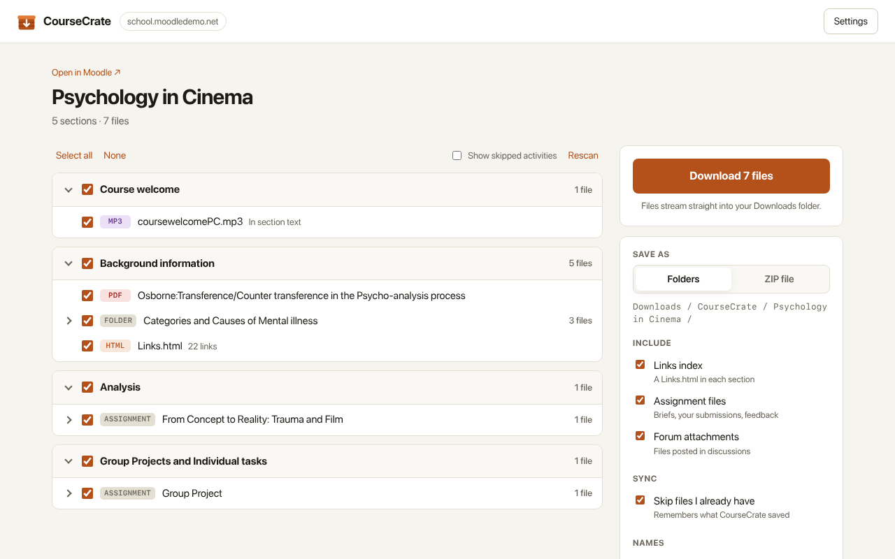

# CourseCrate

Extension that allows Single click to download all the contents from Moodle!

CourseCrate is a browser extension for Firefox and Chrome (and other Chromium browsers such as Edge and Brave) that saves an entire Moodle course to your computer, sorted the way the course is: one folder per section, files numbered in course order. Run it again later in the semester and it only fetches what's new.



## What it saves

| From Moodle | Ends up as |
| --- | --- |
| File activities (PDF, slides, docs, video, audio…) | `03 - Week 3/02 - Lecture slides.pdf` |
| Folder activities, including sub-folders | `03 - Week 3/04 - Readings/…` |
| Files and media in section text and text & media areas | loose in the section folder |
| Files linked inside Pages and Books | `…/05 - Reading guide/…` |
| Assignment briefs, your own submission, teacher feedback | `…/Essay 1/`, `…/Essay 1/My submission/`, `…/Essay 1/Feedback/` |
| Forum attachments | `…/Announcements/<discussion subject>/…` |
| URL activities, web links and embedded YouTube/Vimeo videos | a `Links.html` page in each section |

Quizzes, lessons, H5P, wikis and other online-only activities have nothing to download and are skipped. Use "Show skipped activities" to see them.

Example result:

```
Downloads/CourseCrate/Psychology in Cinema/
├── 00 - Course welcome/
│   └── coursewelcomePC.mp3
├── 01 - Background information/
│   ├── 01 - Osborne - Transference-Counter transference in the Psycho-analysis process.pdf
│   ├── 02 - Categories and Causes of Mental illness/
│   │   ├── CausesMentalIllness.docx
│   │   ├── Classification of mental disorders.pdf
│   │   └── PsychoDefinitions.odt
│   └── Links.html
├── 02 - Analysis/
│   └── 01 - From Concept to Reality - Trauma and Film/ExampleEssay.pdf
└── 03 - Group Projects and Individual tasks/
    └── 01 - Group Project/My submission/GroupFCPresentation.pptx
```

## How to use it

1. Log in to Moodle in your browser and open any page of the course.
2. Click the CourseCrate button in the toolbar. In current Firefox and Chrome it starts in the puzzle-piece (Extensions) menu; pin it for one-click access.
3. The first time you use a Moodle site, allow CourseCrate on it (one click, per site).
4. Untick anything you don't want, choose **Folders** or **ZIP file**, and press **Download**.

Clicking the button outside a course, but on a Moodle page, lists your courses on that site.

### Options

- **Save as**: *Folders* streams each file into `Downloads/CourseCrate/<course>/`, which suits any course size. *ZIP file* packs one `<course>.zip` in memory, up to 4 GB.
- **Include**: Links index, assignment files, forum attachments. Big forums take longer to scan.
- **Sync**: skips files CourseCrate already saved from that course. Moodle gives every new version of a file a new address, so changed files count as new.
- **Names**: number folders and files in course order, and name files after the activity title or keep the original file name.
- **Settings page**: root folder name, files at once, keep the browser's download list tidy, `.url` shortcuts (ZIP only, because browsers refuse to save `.url` files directly).

## How it works

- **No password, no token, no Moodle setup.** CourseCrate makes the same requests your browser makes when you click around, using your existing login cookie.
- **Course structure** comes from `core_courseformat_get_state`, the AJAX call Moodle's own course page uses (Moodle 4.0+). It sees every section and activity whatever the course format or "one section per page" setting. On older Moodle it falls back to reading the course page HTML.
- **Files** come from each activity's page (`mod/resource/view.php?forceview=1`, `mod/folder/view.php`, …), keeping only real course material from `pluginfile.php` (no avatars, logos or theme images).
- **Downloads** go through the browser's download manager (folders mode) or an in-memory, store-only ZIP writer (ZIP mode). There are no third-party libraries.
- **Permissions:** `activeTab` + `scripting` to recognise the Moodle page you clicked on, `downloads` to save files, and `storage` for settings and sync history. Host access is optional and requested per Moodle site.
- **Privacy:** no analytics, no remote servers, no data collection (`data_collection_permissions: none`). See [PRIVACY.md](PRIVACY.md).

Opening activity pages is logged by Moodle the same way as clicking on them, so "viewed" activity completion may tick.

## Development

```sh
npm install
npm test          # unit tests (node:test + linkedom; the ZIP test runs `unzip -t`)
npm run lint      # Mozilla's add-ons linter
npm start         # launch Firefox with the extension loaded
npm run build     # both packages: dist/coursecrate-firefox-<version>.zip and dist/coursecrate-chrome-<version>.zip
npm run build:chrome   # just Chrome: also leaves the unpacked build in build/chrome/
```

Load it by hand:

- **Firefox:** `about:debugging#/runtime/this-firefox` → *Load Temporary Add-on…* → `extension/manifest.json`.
- **Chrome:** `npm run build:chrome`, then `chrome://extensions` → turn on *Developer mode* → *Load unpacked* → `build/chrome/`.

The shipped extension is the `extension/` folder, unbundled and unminified, so what you read is what runs. Both browsers run the same files; only the manifest differs. `scripts/build-chrome.mjs` writes the Chrome one: a background service worker instead of Firefox's event page, and no Gecko-only keys. `lib/compat.js` maps Chrome's `chrome.*` API onto the `browser.*` name the code uses.

```
extension/
├── manifest.json
├── background.js        toolbar button: detect the Moodle course, open CourseCrate
│                        (event page in Firefox, service worker in Chrome)
├── crate.html/.css/.js  the course page (tree, options, progress)
├── options.html/.css/.js
└── lib/
    ├── moodle.js        session-based Moodle client and course crawler
    ├── pluginfile.js    understands Moodle file URLs
    ├── plan.js          crawl result → folder tree and file paths
    ├── download.js      folders mode (downloads API) and ZIP mode
    ├── zip.js           store-only ZIP writer + CRC-32
    ├── linkspage.js     Links.html
    ├── settings.js      settings, sync history, recent courses
    ├── compat.js        `browser` = `chrome` on Chrome
    └── util.js
```

Store listing copy, reviewer notes and screenshots are in [`store/`](store/): `AMO-LISTING.md` for Firefox, `CHROME-WEB-STORE.md` for Chrome.

## Tested against

- Moodle 5.x (Mount Orange demo, `school.moodledemo.net`), Firefox 159, Folders and ZIP modes, from a real toolbar click, including subsections and forum attachments.
- Moodle 5.x demo in Chromium 156 with the Chrome build: course detection from the tab, scan with the existing login, Folders and ZIP modes, sync, plain-http sites.
- Moodle 3.x course layout and Collapsed Topics + subsections markup via unit tests (HTML fallback).

---

Moodle™ is a registered trademark of Moodle Pty Ltd. CourseCrate is an independent project, not affiliated with or endorsed by Moodle.

MIT licensed. See [LICENSE](LICENSE).
